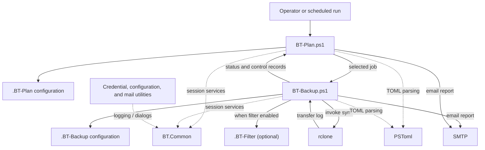

# Architecture

This document describes the current structure and runtime boundaries of Backup-Toolkit. For a detailed catalog of tools, administrative utilities, modules, and dependencies, see [Components](./Components.md). For installation details, see [Installation](./Installation.md). For configuration details, see the relevant user guides linked from the [documentation index](./README.md).

## Runtime overview

Backup-Toolkit is a Windows PowerShell 5.1 application. `BT-Plan` selects and coordinates backup jobs; `BT-Backup` performs each backup by invoking the external `rclone` program. Both core runtime scripts use `BT.Common` for shared session behavior and `PSToml` to read TOML configuration. Supporting credential, configuration, and mail utilities also use `BT.Common` for logging and, where needed, common dialogs.



`BT-Backup` can also run directly, without a plan. When launched by `BT-Plan`, it returns status and control records that the plan uses to aggregate job results and, when configured, send one consolidated report. `BT-Plan-Schedule` configures Windows Task Scheduler; it is an administrative entry point, not part of the backup execution engine.

## Component responsibilities

| Component | Responsibility |
| --- | --- |
| `Tools/BT-Backup.ps1` | Validates a `.BT-Backup`, prepares source and destination paths, runs `rclone sync`, manages backup logs and archives, and optionally reports results. |
| `Tools/BT-Plan.ps1` | Reads a `.BT-Plan`, selects jobs by schedule or command-line override, invokes `BT-Backup`, and aggregates results. |
| `Tools/BT-Shutdown.cmd` | Evaluates INI-configured shutdown checks, optionally sends a notification, and invokes Windows shutdown. |
| `Tools/Admin/` | Administrative utilities for scheduling and Windows integration, separate from the backup engine. |
| `Tools/Modules/BT.Common/` | Shared logging, message and file dialogs, timestamps, session locks, temporary directories, formatting, and controlled exit behavior. Used by `BT-Backup`, `BT-Plan`, `BT-File-Credentials`, `BT-File-Get-Password`, `BT-Mail-Credentials`, `BT-Mail-Send`, and `BT-Rclone-Config`. |
| `Tools/Modules/PSToml/` | Bundled TOML parser used by the runtime scripts. |
| `Tools/Utilities/Rclone/` | Default location for the external `rclone` executable. |
| Other `Tools/BT-*.ps1` scripts | Manage credentials, rclone configuration, and mail. |

Most `.cmd` files are Windows command-shell launchers for their corresponding PowerShell scripts. They provide a convenient entry point and, where applicable, default parameters. `BT-Shutdown.cmd` is implemented entirely in batch and has no PowerShell counterpart.

## Source repository directory map

| Directory | Purpose |
| --- | --- |
| `Tools/` | Runtime commands, launchers, modules, and utilities shipped with the toolkit. |
| `Docs/` | User guides and technical reference; see [Docs/README.md](README.md). |
| `Examples/` | Runnable examples, sample configurations, and a sample repository layout; see [Examples/README.md](../Examples/README.md). |
| `Tests/` | Local test workspace. Its contents are not tracked; see [Tests/README.md](../Tests/README.md). |
| `Config/` | Local configuration for this installation. It may contain credentials or other sensitive data and is not tracked, except for its [Config/README.md](../Config/README.md). |

## Installation and operational data

**BackupToolkitHome** is the toolkit installation directory, referred to as `BTPath` in scripts and informally as the *Backup-Toolkit home*. Its typical folder name is `BackupToolkit/`. The release includes `Tools/`, `Docs/`, `Examples/`, and the top-level shell launcher. `Config/` and `Tests/` may also exist there as local directories, but are not part of the release. A typical layout is:

```text
BackupToolkit/
  Start-BackupToolkitShell.cmd
  Tools/
    Admin/
    Modules/
    Utilities/
  Docs/
  Examples/
  Tests/                        # optional local test data; preserve during updates
  Config/                       # optional local configuration; preserve during updates
```

Operational backup files are organized separately in a **BackupRepository**, which may be located elsewhere. Its typical folder name is `BackupRepository/` (alternatively, `BTRepository/` or `Backups/`). Multiple **BackupRepositories** may coexist (e.g. per drive, purpose, or environment). A typical layout is:

```text
BackupRepository/
  BackupData/
    <backup_name>/
      <backup_name>.BT-Backup
      <backup_name>.BT-Filter     # optional rclone filter configuration
      logs/
      current/                  # current backup contents (Colocated Backup only)
      archive/                  # timestamped copies of changed or removed files (Colocated Backup only)
  BackupPlan/
    *.BT-Plan
    logs/
  BackupSystem/
    BT-Shutdown.*.ini
    logs/
  Config/                       # rclone configuration and credentials
  Locks/                        # active-session lock files
  Temp/                         # alternative to the default %TEMP% location for session temp files
```

For a **Split Backup**, the payload is kept in **BackupStorage**, a container analogous to `BackupData/` but located outside the **BackupRepository**. Its per-Backup subfolders (each a **BackupHome**) hold only the payload (`current/` and `archive/`), not configurations or logs. Its typical folder name is `BackupStorage/` (alternatively, `BTStorage/`). **BackupStorage** may be on the same computer (e.g. on a separate volume), another computer, or remote cloud storage accessed through rclone. A typical layout is:

```text
BackupStorage/                  # separate local or remote payload storage
  <backup_name>/
    current/                    # current backup contents
    archive/                    # timestamped copies of changed or removed files
```

With a **Colocated Backup**, the payload (`current/` and `archive/`) is under `BackupData/<backup_name>/`. With a **Split Backup**, configuration and logs stay under `BackupData/<backup_name>/`, while the payload uses the separate `BackupStorage/<backup_name>/` layout above. See [Glossary](./Glossary.md) and the individual tool guides.

Each `BT-Plan` or `BT-Backup` session writes its own log and uses a lock file to prevent conflicting runs. Session temporary files are created under the configured temporary path and cleaned up at the end of the run.

## Configuration and security boundaries

- **BackupToolkitHome** can be installed at a user-selected location. Directory names and locations in the operational **BackupRepository** and **BackupStorage** layouts can be customized; the payload directory names `current/` and `archive/` are fixed.
- `.BT-Plan` and `.BT-Backup` files are TOML inputs parsed by `PSToml`; shutdown configuration uses INI files.
- `rclone` performs data transfers. Remote names and settings come from rclone configuration, which can be encrypted and managed with `BT-Rclone-Config`.
- Credential utilities protect secrets for use by the toolkit. DPAPI-protected credentials are tied to the Windows user context that created them; real credentials and local configuration must not be committed to source control.
- Administrative utilities integrate with Windows Task Scheduler or per-user file associations. These operations are distinct from normal backup runs and have their own permission and confirmation requirements.

## Testing and validation

The repository currently has no tracked automated test suite. The `Tests/` directory is reserved for local tests and data; its contents may be sensitive and are intentionally excluded from version control. For operational validation, use each tool's documented validation modes and the runnable scenarios in [`Examples/`](../Examples/README.md); check destructive or write-enabled examples carefully before execution.

## Related Documentation

- [Components](./Components.md)
- [Glossary](./Glossary.md)
